# Healthcare services application for Odisha: MVP Version 1 requirements

- **Version:** MVP (Minimum Viable Product) Version 1 reference guide
- **Date:** 3 October 2026
- **Status:** Draft for review. Regulatory points and phase lengths are unverified estimates; see the notes in the security and delivery sections.

## Contents

1. [Summary](#summary)
2. [Users and roles](#users-and-roles)
3. [Scope of the first release](#scope-of-the-first-release)
4. [Security and data protection by design](#security-and-data-protection-by-design)
5. [Core user journeys](#core-user-journeys)
6. [Functional requirements](#functional-requirements)
7. [Admin panel (desktop first)](#admin-panel-desktop-first)
8. [Cross-cutting requirements](#cross-cutting-requirements)
9. [Architecture and tech stack](#architecture-and-tech-stack)
10. [Definition of done for every feature](#definition-of-done-for-every-feature)
11. [Delivery plan, metrics, risks and open questions](#delivery-plan-metrics-risks-and-open-questions)

## Summary

This document sets out the requirements for the Minimum Viable Product (MVP): the first release of a mobile-first web application that lets patients in Odisha find, book and pay verified care providers. "MVP" here is the release stage, not the product name. Its working name is HEACH (the final name is an open question); this document calls it "the application".

The first release covers six services: online doctor consultation, physiotherapy at home, nursing procedures at home, bedside attendant care, in-clinic appointments for dental and skin treatment, and lab test booking. An e-medical report vault keeps each patient's prescriptions, reports and medical history in one encrypted place. Subscriptions, care packages and referral rewards sit across all six services.

Providers onboard themselves, prove their identity through Aadhaar and DigiLocker, are verified by an admin, and then publish their services. Patients or their representatives book, receive the service, and leave a rating. A desktop-first admin panel handles verification, bookings oversight, disputes, finance and content.

Security and encryption of patient data are designed in from the first commit, ahead of any feature. Six further quality attributes are checked on every feature: performance, accessibility, automated testing (unit and E2E), logging and monitoring, user experience, and multi-language support (Odia, English, Hindi).

Requirement IDs (for example `BK-03`) are stable so they can be used as backlog references.

## Users and roles

Ten roles use the application; one account can hold a patient role and one provider role. Every provider proves identity through Aadhaar and DigiLocker before an admin reviews professional documents.

| Role | Primary device | What they do in the first release | Verification needed |
| --- | --- | --- | --- |
| Patient | Mobile | Search, book, pay, attend consult or receive service, keep prescriptions, reports and medical history in the vault, rate | Mobile OTP. Aadhaar or DigiLocker identity check is optional |
| Patient representative | Mobile | Does everything a patient does, including managing the vault, on behalf of one or more linked patients (parent, child, elderly relative) | Mobile OTP, declared relationship. Aadhaar or DigiLocker identity check optional, as for patients |
| Doctor (online consultation) | Mobile, tablet | Publishes online consultation services, sets availability and fees, conducts consults, issues prescriptions | Aadhaar identity check; DigiLocker documents (PAN, degree certificate where issued); medical council registration number and certificate |
| Dentist or dermatologist (in-clinic) | Mobile, tablet | Publishes clinic, treatments and fees; manages appointment slots; records visit summary | Aadhaar identity check; DigiLocker documents; State Dental Council or medical council registration; clinic address proof and clinical establishment registration |
| Physiotherapist | Mobile | Publishes home-visit services, service area and fees; accepts and completes visits | Aadhaar identity check; DigiLocker documents (degree where issued); BPT/MPT degree; council or association registration where available |
| Nurse / paramedical staff | Mobile | Posts home-visit procedures (injection, wound cleaning and dressing, and similar); accepts and completes visits | Aadhaar identity check; DigiLocker documents; nursing council registration (ANM/GNM/B.Sc) |
| Bedside care attendant | Mobile, often low-end Android | Self-onboards, lists shift types and rates, accepts assignments | Aadhaar identity check with photo match; DigiLocker documents where available; address proof; training certificate if any; one reference |
| Diagnostic lab (partner) | Desktop, tablet | Publishes test catalogue and prices, manages collection slots, uploads reports | Owner or signatory Aadhaar identity check; PAN and GST via DigiLocker where issued; clinical establishment registration; NABL accreditation if held |
| Sample collector (phlebotomist) | Mobile | Receives collection assignments, collects samples at home, updates status | Aadhaar identity check; qualification certificate (DMLT or equivalent); linked to a verified lab |
| Admin (super admin, verifier, support, finance) | Desktop | Verifies providers, manages catalogue, monitors bookings, handles complaints, refunds and payouts | Internal account with MFA; background-checked staff |

How Aadhaar and DigiLocker verification works (see module KY for the requirements):

- The user gives explicit consent, then completes Aadhaar verification or signs in to DigiLocker and shares chosen documents. The application receives name, date of birth, gender, photo and address, plus the documents shared.
- The full Aadhaar number is never stored. Only a masked reference (last four digits), the verification result, a timestamp and the provider's transaction reference are kept.
- Name and photo from the identity check are matched against the profile and the professional registration. A mismatch goes to manual review.
- Identity verification does not replace professional verification. An admin still checks the registration number against the relevant council register.
- A manual fallback (document upload, reviewed by a verifier) exists for people whose Aadhaar is not linked to their mobile number.

Design implications:

- Attendants and many patients have limited digital literacy. Their flows need large touch targets, icons with text, Odia by default, and minimal typing.
- Representatives are a first-class concept: every booking records both *who booked* and *who receives care*.
- Provider roles differ mainly in verification documents and service templates, so they share one onboarding framework.

## Scope of the first release

The first release delivers one complete loop for each of the six services: onboard, list, discover, book, deliver, pay, rate.

### In scope

- Mobile OTP sign-up and login for all non-admin roles
- Aadhaar and DigiLocker identity verification, mandatory for providers and optional for patients
- Self-onboarding with document upload for doctors, dentists, dermatologists, physiotherapists, nurses, attendants and labs
- Admin verification before any listing goes live
- Online doctor consultation with video, audio fallback and digital prescription
- Physiotherapy home visits
- Nursing home visits (injection, wound cleaning and dressing, and similar)
- Bedside attendant care by shift
- In-clinic appointment booking for dental and skin treatment
- Lab test booking with home sample collection or lab walk-in, and digital reports
- E-medical report vault for prescriptions, reports and medical history, with consent-based sharing
- Search and filter by service type, location (district, town, PIN code), language, fee, availability and rating
- Care packages (prepaid bundles of sessions or visits)
- Subscriptions (recurring care plans with auto-renewal)
- Referral rewards for patients and for provider onboarding, given as discount coupons
- Online payment (UPI, cards, net banking), UPI Autopay for subscriptions, and refunds
- Notifications by SMS and in-app; WhatsApp where template approval is in place
- Ratings and reviews after a completed service
- Admin panel: verification, users, catalogue, bookings, labs, plans, referrals, finance, complaints, content, reports
- Encryption, access control and audit for all patient data, from the first sprint
- Odia, English and Hindi across patient and provider apps

### Out of scope for the first release

- Native Android or iOS apps (the PWA is installable)
- Emergency or ambulance services; the app shows a clear "not for emergencies, call 108" notice
- In-clinic booking for specialities other than dental and skin
- Pharmacy ordering and insurance claims
- Wallet (stored balance for refunds, reward credits or top-up); refunds go back to the original payment method
- ABDM (ABHA) integration and exchange of records with hospital systems
- Live GPS tracking of providers en route
- AI symptom checker or triage

### Assumptions

- Launch geography is Odisha only; providers set a service area by district and PIN codes.
- The application is an intermediary: it connects patients to independent providers, clinics and labs, and does not employ them.
- Revenue comes from a commission per completed booking, plus plan fees; percentages are admin-configurable.
- Most patient traffic is on Android phones over 4G with patchy coverage outside cities.
- With six services, the vault, plans and referrals in scope, the first release is built and released in stages (see the delivery plan) rather than in one launch.

## Security and data protection by design

Patient data is sensitive and confidential, so security and encryption are the first thing built and a gate on every feature. Nothing in this section is deferred to a later hardening phase. The regulatory points at the end are from general knowledge and were not checked against current sources; a healthcare lawyer should confirm them before launch.

### Data classification (DC)

Every field in the data model carries one of four classes; the class decides encryption, access, logging and retention.

| Class | Examples | Handling |
| --- | --- | --- |
| Restricted | Health information (reason for visit, notes, prescriptions, lab reports, wound photos), identity verification results, bank and UPI details | Field-level encryption, access only for the treating provider and the patient, every read audited, never in logs, URLs, SMS or push text |
| Confidential | Name, mobile number, address, date of birth, booking details, provider documents | Encrypted at rest, role-based access, masked in admin lists and logs |
| Internal | Listings drafts, configuration, operational metrics | Access for staff by role |
| Public | Approved provider profiles, catalogue, prices | Served openly; no personal patient data |

### Encryption (EN)

| ID | Requirement |
| --- | --- |
| EN-01 | Encryption in transit everywhere: TLS 1.3 (1.2 minimum) with HSTS for all browser, API and service-to-service traffic, including database and cache connections. |
| EN-02 | Encryption at rest with AES-256 for databases, object storage, queues, search indexes, backups and log stores. |
| EN-03 | Field-level (application-layer) encryption for all Restricted data before it reaches the database, so that a database administrator or a leaked dump cannot read it. |
| EN-04 | Envelope encryption: data keys are protected by master keys held in a managed key management service or HSM in an India region; application code never sees master keys. |
| EN-05 | Key rotation: master keys at least yearly, data keys on a schedule and immediately on suspected compromise; old data stays readable through key versioning. |
| EN-06 | Separate keys per environment and per data domain (health records, identity, payments, documents), so one compromised key exposes one domain only. |
| EN-07 | Uploaded files (reports, prescriptions, identity and qualification documents) are encrypted per object, stored in private buckets, virus-scanned, and served only through short-lived signed URLs after an access check. |
| EN-08 | Video and audio consultation media are encrypted in transit (DTLS-SRTP); calls are not recorded; the video provider must not store media. |
| EN-09 | Searchable Restricted fields (for example mobile number lookup) use keyed hashes (blind indexes), not plaintext copies. |
| EN-10 | Backups are encrypted with separate keys, stored in a second India region, and restore-tested quarterly. |
| EN-11 | On the device: no Restricted data (including vault records) in localStorage, service-worker caches or URLs; offline data is limited to non-sensitive booking summaries and is wiped at logout. |
| EN-12 | Secrets (API keys, credentials) live in a secrets manager, are rotated, and are never in source code, images or logs; CI blocks commits containing secrets. |
| EN-13 | Automated tests assert that Restricted fields are ciphertext in the database and absent from logs and API responses to unauthorised roles. |

### Access control and audit (SE)

| ID | Requirement |
| --- | --- |
| SE-01 | Least privilege: a provider sees a patient's details only for their own active or recent bookings; a lab sees only the tests ordered from it. |
| SE-02 | Authorisation is enforced on the server for every request and every object (no reliance on hidden UI); tests cover cross-user access attempts. |
| SE-03 | Admins see Restricted data only through a "break-glass" action tied to a ticket, with a stated reason, time limit and audit entry. |
| SE-04 | Admin panel requires MFA, short sessions, IP allow-listing or device trust, and has no bulk export of Restricted data without super-admin approval. |
| SE-05 | Tamper-evident audit log of every read and write of Restricted data and every admin action, stored separately from application logs and retained per policy. |
| SE-06 | Patients can see who accessed their records and when. |
| SE-07 | Session security: short-lived access tokens, rotating refresh tokens in secure HTTP-only cookies, logout from all devices, re-verification by OTP for sensitive actions. |
| SE-08 | OTP rate limiting, device and IP throttling, and bot protection on sign-up, login and referral redemption. |
| SE-09 | Screens with Restricted data set no-store cache headers; SMS, push and WhatsApp messages carry no health details, only a prompt to open the app. |

### Privacy and consent (PR)

| ID | Requirement |
| --- | --- |
| PR-01 | Purpose-specific, plain-language consent in the user's language at sign-up, before identity verification, before teleconsultation and before sharing a report with a provider; consent records are stored and can be withdrawn. |
| PR-02 | Data minimisation: each feature collects only the fields it needs; the data model review rejects unused personal fields. |
| PR-03 | The full Aadhaar number is never stored or logged; only a masked reference and the verification result are kept. |
| PR-04 | Users can view, correct, export and request deletion of their data; requests are completed within a defined time. |
| PR-05 | Retention schedule per data class; data past retention is deleted or irreversibly anonymised by an automated job. |
| PR-06 | All data is hosted and processed in India regions; third-party processors sign data processing agreements. |
| PR-07 | Analytics and monitoring tools receive no Restricted data and only pseudonymous identifiers. |

### Secure development and operations (SO)

| ID | Requirement |
| --- | --- |
| SO-01 | Threat model for each module before build, updated when the design changes. |
| SO-02 | OWASP ASVS level 2 as the build standard; OWASP Top 10 checks in code review. |
| SO-03 | CI runs static analysis, dependency and container scanning, and secret scanning on every pull request; high-severity findings block the merge. |
| SO-04 | Dynamic security scan against staging before each release; independent penetration test before each staged launch and yearly after. |
| SO-05 | Security headers (CSP, HSTS, frame and referrer policies), input validation and output encoding as shared middleware. |
| SO-06 | Production access is by named individuals with MFA through a bastion or zero-trust proxy; no shared accounts; access reviewed quarterly. |
| SO-07 | Production data is never copied to development or staging; test data is synthetic. |
| SO-08 | Web application firewall, DDoS protection and anomaly alerts (unusual read volumes, repeated authorisation failures). |
| SO-09 | Breach response plan with a named owner, a rehearsed runbook and a notification procedure for users and regulators. |
| SO-10 | Recovery point 24 hours and recovery time 4 hours for the first release. |

### Regulatory points to confirm

- **Digital Personal Data Protection Act, 2023 and its Rules.** Notice and consent, purpose limitation, rights to access, correct and erase, breach notification, and verifiable consent of a parent or guardian for children's data.
- **Aadhaar and DigiLocker.** Aadhaar-based verification is available to private applications only through permitted routes (for example DigiLocker, offline Aadhaar verification, or a licensed verification partner). The route, the consent wording and the rule against storing Aadhaar numbers need confirming.
- **Telemedicine Practice Guidelines (2020).** Online consultation is limited to registered medical practitioners; the doctor's registration number must appear on the profile and prescription; patient consent and identification are required; certain medicine categories cannot be prescribed by teleconsult.
- **Professional and establishment registration.** Doctors with the state medical council or National Medical Register; dentists with the State Dental Council; nurses with the Odisha Nurses and Midwives Council; physiotherapists under the allied and healthcare professions framework; clinics and labs under Odisha's clinical establishments law.
- **Bedside attendants** are non-clinical caregivers. Listings and UI must not present them as nurses or allow them to offer clinical procedures.
- **Home procedures and lab tests.** Injections and similar procedures should require a valid prescription upload; some lab tests may also need one.
- **Medical records.** How long provider-issued records (prescriptions, visit notes, lab reports) must be kept, and how that interacts with a patient's request to erase data, needs confirming.
- **Subscriptions.** Recurring payments must follow e-mandate rules (pre-debit notification, easy cancellation).
- **Referral rewards.** Medical ethics rules restrict payments to practitioners for referring patients. Rewards are limited to patients inviting patients and to provider onboarding, never paid for steering a patient to a provider.
- **Intermediary position.** Terms of use, provider agreement, grievance officer details and a complaints process must be published in all three languages.
- **Payments.** GST treatment of healthcare services versus platform commission, plan fees and referral discounts, and TDS on provider payouts, need advice from a tax professional.

## Core user journeys

Nine journeys define the first release; each must be completable on a 360 px wide phone in the user's chosen language.

### J1. Provider self-onboarding (all provider types)

1. Choose language, enter mobile number, verify OTP.
2. Choose role: doctor, physiotherapist, nurse or paramedic, bedside attendant.
3. Fill profile: name, photo, gender, languages spoken, experience, qualifications.
4. Give consent and complete Aadhaar and DigiLocker identity verification; details are filled in from the verified record.
5. Upload role-specific professional documents (camera capture supported).
6. Accept provider terms and code of conduct.
7. Submit; status shows "Under review" with expected turnaround.
8. Admin approves, rejects with reason, or asks for re-upload; provider is notified by SMS.
9. Once approved, provider creates listings and sets availability.

### J2. Patient books an online doctor consultation

1. Search by speciality, symptom keyword or doctor name; filter by language, fee, next available slot.
2. Open doctor profile; choose patient (self or linked person) and a slot.
3. Enter reason for consult; optionally upload reports or photos; give telemedicine consent.
4. Pay; receive confirmation by SMS and in-app.
5. Join the video call from the booking screen at the slot time; switch to audio if the network is weak.
6. Doctor records notes and issues a prescription; patient downloads it as PDF.
7. Patient rates the consultation. A free text follow-up window is open for a configurable period.

### J3. Patient books a home visit (physiotherapist or nurse)

1. Choose service (for example "Injection at home", "Wound dressing", "Post-surgery physiotherapy").
2. Enter or pick address; the app shows only providers who serve that PIN code.
3. Choose provider and slot; upload the doctor's prescription where the service requires one.
4. Pay; provider receives the request and accepts or declines within a set window.
5. On arrival the provider enters the patient's start OTP; on finishing, records visit notes and marks complete.
6. Patient confirms and rates.

### J4. Patient books a bedside attendant

1. Choose care setting (home or hospital), shift type (12-hour day, 12-hour night, 24-hour), start date and number of days.
2. State patient needs: mobility, feeding, toileting, gender preference for the attendant.
3. Choose from matching attendants; pay an advance or the full amount.
4. Attendant accepts; each shift starts and ends with an OTP check-in.
5. Patient can extend, end early or request a replacement through support.

### J5. Admin verifies a provider

1. Open the verification queue, sorted by oldest first, filtered by role.
2. Review the identity verification result, profile and documents side by side; check registration number against the relevant council register.
3. Approve, reject with a reason from a standard list, or request a re-upload.
4. Every decision is written to an audit log with admin ID and timestamp.

### J6. Patient books an in-clinic appointment (dental or skin)

1. Choose "Dental" or "Skin", then a treatment or a general consultation.
2. See clinics by distance, fee, rating and next available slot; open a clinic profile with address, map and photos.
3. Choose patient and slot; pay the booking fee or the full amount, or choose pay at clinic where the clinic allows it.
4. Receive confirmation with directions and a check-in code.
5. Check in at the clinic with the code; the clinic marks the visit complete and records a visit summary and any follow-up date.
6. Patient rates the visit; a follow-up appointment can be booked in one step.

### J7. Patient books a lab test

1. Search tests or packages (for example "CBC", "Thyroid profile", "Diabetes check"); see price, preparation such as fasting, and report time.
2. Choose home sample collection or lab walk-in, then a lab, address and slot.
3. Upload a prescription where the test requires one; pay.
4. For home collection, a sample collector is assigned; the patient confirms collection with an OTP.
5. Track status: booked, collector assigned, sample collected, at lab, report ready.
6. Download the report in the app; optionally share it with a doctor on the application for a consultation.

### J8. Patient buys a care package or subscription, and uses a referral reward

1. Browse plans: care packages (for example 10 physiotherapy sessions) and subscriptions (for example a monthly family care plan).
2. See what is included, validity, price, renewal and cancellation terms before paying.
3. Pay; for subscriptions, approve a UPI Autopay mandate.
4. Book included services at no extra charge until the entitlement is used or expires; the app shows what is left.
5. Share a referral code; when the invited person completes a first booking, both receive a discount coupon.
6. Apply the coupon at checkout on a later booking; any refund goes back to the original payment method.

### J9. Patient keeps and shares records in the medical report vault

1. Open "My records"; choose self or a linked patient.
2. See a timeline of records: prescriptions, visit notes and lab reports from the application appear automatically.
3. Add an older record by photo or PDF; set its type, date and doctor or hospital.
4. Fill in medical history: allergies, long-term conditions, current medicines, past surgeries, blood group.
5. When booking, choose which records the provider may see; access ends automatically after the booking window.
6. Review who has viewed the records; revoke a share or download a record at any time.

## Functional requirements

Every requirement below is a "Must" for the first release; fast-follow items are listed at the end of the section.

### Accounts and access (AC)

| ID | Requirement |
| --- | --- |
| AC-01 | Sign up and log in with mobile number and SMS OTP; no password for patients and providers. |
| AC-02 | Language is chosen on first launch and can be changed at any time from any screen. |
| AC-03 | A user can add, edit and remove linked patients (name, age, gender, relationship) and book for them. |
| AC-04 | Role-based access control: patient, representative, each provider type, admin sub-roles. |
| AC-05 | Sessions persist on the device; sensitive actions (payout details, account deletion) re-verify by OTP. |
| AC-06 | Users can view, correct and request deletion of their personal data. |

### Provider onboarding and profile (PO)

| ID | Requirement |
| --- | --- |
| PO-01 | One onboarding framework with role-specific fields and document checklists, configurable by admin. |
| PO-02 | Document upload from camera or files (JPEG, PNG, PDF up to 5 MB), with client-side compression; files are encrypted and virus-scanned on receipt. |
| PO-03 | Onboarding can be saved and resumed; progress indicator shows steps left. |
| PO-04 | Profile status: Draft, Submitted, Under review, Changes requested, Approved, Rejected, Suspended. |
| PO-05 | Public profile shows photo, qualifications, registration number (doctors, nurses), experience, languages, rating, and a "Verified" badge. |
| PO-06 | Provider enters bank account or UPI ID for payouts; changes require OTP. |
| PO-07 | Attendant onboarding works with voice-assisted prompts and minimal text entry; an assisted mode lets an admin or field agent complete it for them. |

### Identity verification with Aadhaar and DigiLocker (KY)

| ID | Requirement |
| --- | --- |
| KY-01 | Aadhaar-based identity verification through a permitted route (DigiLocker, offline Aadhaar verification or a licensed partner), with explicit consent captured first. |
| KY-02 | DigiLocker sign-in lets the user share issued documents (Aadhaar, PAN, driving licence, degree or registration certificates where the issuer supports it); shared documents are stored as verified copies. |
| KY-03 | Verified name, date of birth, gender, photo and address pre-fill the profile and cannot be edited without re-verification. |
| KY-04 | Name and photo are matched against the profile and professional registration; mismatches are flagged for manual review. |
| KY-05 | The Aadhaar number is never stored; only the last four digits, result, timestamp and transaction reference are kept, encrypted as Restricted data. |
| KY-06 | Identity verification is mandatory for all providers before submission, and optional for patients and representatives. |
| KY-07 | Manual fallback: upload of an identity document reviewed by a verifier, for users who cannot complete Aadhaar or DigiLocker verification. |
| KY-08 | The identity provider sits behind an adapter so it can be changed; failures and timeouts let the user retry or switch to the fallback. |
| KY-09 | A "Verified identity" badge is shown on provider profiles; verification status and method are visible to admins. |

### Service listings (SL)

| ID | Requirement |
| --- | --- |
| SL-01 | Doctors list online consultation services: speciality, consult type (video, audio), duration, fee, follow-up policy. |
| SL-02 | Physiotherapists list home-visit services from a standard catalogue (for example orthopaedic rehab, neuro rehab, post-operative, geriatric) with session length and fee. |
| SL-03 | Nurses list home-visit procedures from a standard catalogue: injection (IM, IV, SC), wound cleaning and dressing, catheter care, vitals check, IV fluids; each with a fee. |
| SL-04 | Attendants list shift types, daily rate, care settings (home, hospital), tasks they perform, and gender. |
| SL-05 | Home-visit providers define a service area by district and PIN codes, and an optional travel surcharge. |
| SL-06 | Catalogue items flag whether a doctor's prescription is mandatory before booking (for example injections). |
| SL-07 | Providers can pause and resume a listing without admin action. |
| SL-08 | Dentists and dermatologists list a clinic (name, address, map pin, photos, timings) and treatments from a standard catalogue with fee or fee range. |
| SL-09 | Labs list tests and test packages from a standard catalogue with price, preparation instructions, sample type, report time, and whether home collection is offered. |

### Availability and scheduling (AV)

| ID | Requirement |
| --- | --- |
| AV-01 | Weekly recurring availability plus date-specific overrides and leave days. |
| AV-02 | Slots are generated from availability and service duration; a slot is locked for 10 minutes during checkout. |
| AV-03 | Buffer time between home visits is configurable by the provider. |
| AV-04 | All times are shown in IST; no time-zone handling in the first release. |

### Search and discovery (SD)

| ID | Requirement |
| --- | --- |
| SD-01 | Home screen offers the six service types as large tiles, with "My records" and plans reachable from the main navigation. |
| SD-02 | Search by speciality, service name or provider name, with tolerance for Odia, Hindi and English spellings. |
| SD-03 | Filters: location, language spoken, gender, fee range, earliest availability, rating. |
| SD-04 | Home-visit results are limited to providers serving the patient's PIN code. |
| SD-05 | Public listing and profile pages are server-rendered and indexable for search engines. |

### Booking (BK)

| ID | Requirement |
| --- | --- |
| BK-01 | A booking records: booker, care recipient, provider, service, slot or shift range, address (home services), fee breakdown, status. |
| BK-02 | Statuses: Pending payment, Requested, Confirmed, In progress, Completed, Cancelled (by patient, provider or admin), No-show, Refunded. |
| BK-03 | Consultation bookings confirm instantly on payment; home-visit and attendant bookings need provider acceptance within a configurable window, else auto-cancel and refund. |
| BK-04 | Patient and provider can cancel or reschedule under a policy that is shown before payment. |
| BK-05 | Patient can attach reports, photos and prescriptions to a booking, from the device or from the vault. |
| BK-06 | Reminders are sent 24 hours and 15 minutes before the slot. |
| BK-07 | Booking history and upcoming bookings are available to patient and provider; a non-sensitive summary (service, time, provider name) is readable offline and wiped at logout. |
| BK-08 | A booking can be paid by gateway payment, plan entitlement, or a combination, with any discount coupon applied; the fee breakdown shows each. |
| BK-09 | Follow-up or repeat bookings can be created from a completed booking in one step. |

### Online consultation (OC)

| ID | Requirement |
| --- | --- |
| OC-01 | In-browser video call with no extra app; pre-call check of camera, microphone and network. |
| OC-02 | Automatic fallback to audio-only on poor bandwidth; in-call text chat. |
| OC-03 | Explicit patient consent to teleconsultation is captured and stored with the booking. |
| OC-04 | Doctor sees patient details, reason for visit and attachments before and during the call. |
| OC-05 | Doctor writes consultation notes and a prescription (medicines, dosage, advice, follow-up date); the prescription PDF carries the doctor's name, qualification and registration number, and is filed in the patient's vault. |
| OC-06 | Waiting room shows queue status; either party is alerted if the other has not joined after 5 minutes. |
| OC-07 | Calls are not recorded in the first release. |

### Home service delivery (HS)

| ID | Requirement |
| --- | --- |
| HS-01 | Provider accepts or declines a request; patient is notified of either outcome. |
| HS-02 | Provider sees address, landmark, contact number and a map link once the booking is confirmed. |
| HS-03 | Service start is confirmed by a one-time code shown to the patient and entered by the provider. |
| HS-04 | Provider records visit notes (procedure done, observations, next visit advice) and marks complete. |
| HS-05 | Attendant bookings record a check-in and check-out for each shift. |
| HS-06 | Both parties have an in-app "Report a safety concern" action that raises a high-priority ticket. |

### In-clinic appointments: dental and skin (IC)

| ID | Requirement |
| --- | --- |
| IC-01 | Treatment catalogue for dental (consultation, scaling, filling, root canal, extraction, orthodontic consultation and similar) and skin (consultation, acne care, pigmentation, hair and scalp, minor procedures and similar), managed by admin. |
| IC-02 | Clinic profile with address, map link, timings, photos, facilities, doctors at the clinic and languages spoken. |
| IC-03 | Search by treatment, clinic or doctor, with distance from the patient's location or PIN code. |
| IC-04 | Slot booking against the clinic's schedule; clinics can choose instant confirmation or manual acceptance. |
| IC-05 | Payment options per clinic: booking fee online, full amount online, or pay at clinic; the remaining amount due is shown clearly. |
| IC-06 | Check-in at the clinic by code or QR; clinic staff can mark arrived, in treatment, completed or no-show. |
| IC-07 | Clinic staff can add walk-in and phone bookings so the schedule stays accurate. |
| IC-08 | Doctor records a visit summary, prescription and follow-up date; the patient sees them in the booking. |
| IC-09 | Multi-sitting treatments (for example root canal) can be booked as a linked series or sold as a care package. |
| IC-10 | A clinic account supports several doctors and a front-desk role with no access to clinical notes. |

### Lab test booking (LB)

| ID | Requirement |
| --- | --- |
| LB-01 | Test and package catalogue with standard names, common names in three languages, preparation instructions, sample type and report time. |
| LB-02 | Patient chooses home sample collection or lab walk-in; home collection is limited to labs serving the PIN code. |
| LB-03 | A cart allows several tests for one patient in one booking; the price and any home collection charge are shown before payment. |
| LB-04 | Prescription upload where a test requires it; the lab can reject with a reason and trigger a refund. |
| LB-05 | The lab assigns a sample collector; the patient sees the collector's name, photo and verified badge. |
| LB-06 | Sample collection is confirmed by a one-time code from the patient; each sample carries a booking-linked identifier. |
| LB-07 | Status tracking: booked, collector assigned, sample collected, received at lab, report ready, with a notification at each step. |
| LB-08 | The lab uploads the report as PDF; it is stored encrypted as Restricted data and visible only to the patient, the booker and the lab. |
| LB-09 | Reports are filed in the patient's vault automatically and shared with doctors through vault sharing (MV-07). |
| LB-10 | Re-collection and report correction flows, with reasons recorded. |
| LB-11 | Lab dashboard: today's collections, pending reports, turnaround time against promised time. |

### E-medical report vault (MV)

| ID | Requirement |
| --- | --- |
| MV-01 | Every patient, and every linked patient, has a vault holding documents and a medical history profile. |
| MV-02 | Records created on the application are filed automatically: prescriptions, consultation notes meant for the patient, home-visit notes, clinic visit summaries and lab reports. |
| MV-03 | Patients can upload their own records by camera or file (JPEG, PNG, PDF up to 10 MB): old prescriptions, lab reports, scans, discharge summaries, vaccination records. |
| MV-04 | Each record has a type, record date, doctor or facility, the person it belongs to, optional tags and notes; uploaded records are marked "added by patient" and application records "issued by" the provider. |
| MV-05 | Medical history profile with structured entries: allergies, long-term conditions, current medicines, past surgeries and hospital stays, blood group, vaccinations, family history. Each entry shows who added it and when. |
| MV-06 | Timeline view, newest first, with filters by person, record type, date range and provider, and search on titles, tags and provider names. |
| MV-07 | Consent-based sharing: the patient selects records, or the history profile, to share with a specific provider for a specific booking. Access is view-only, time-limited and revocable. |
| MV-08 | During a booking, the provider sees a "Shared records" panel with only what was shared; nothing else in the vault is visible or discoverable. |
| MV-09 | Sharing with a doctor outside the application through a link that expires, needs a one-time code, and can be revoked. |
| MV-10 | The patient sees an access history for each record: who viewed it, when, and under which share. |
| MV-11 | All vault content is Restricted data: encrypted per object and per field (EN-03, EN-07), virus-scanned on upload, never cached on the device, never visible to admins except by break-glass (SE-03). |
| MV-12 | Patients can download any record, export the whole vault, and delete records they uploaded. Provider-issued records cannot be edited; removal follows the retention policy. |
| MV-13 | A representative manages a linked patient's vault. When that person creates their own account, the vault transfers to them after identity confirmation, and the representative keeps access only with their consent. |
| MV-14 | Providers can add a note or record to a patient's vault only within a booking; it is attributed to them. |
| MV-15 | Storage quota per account is admin-configurable; the user is warned before reaching it. |
| MV-16 | Uploads work on weak networks: client-side compression, resumable upload, clear progress and retry. |

### Care packages and subscriptions (PK)

| ID | Requirement |
| --- | --- |
| PK-01 | Admin and providers can define care packages: a fixed bundle of sessions or visits at a package price (for example 10 physiotherapy sessions, 7 daily dressings, 30 days of attendant care, a dental treatment plan). Provider-defined packages need admin approval. |
| PK-02 | Admin can define subscriptions: recurring plans (monthly, quarterly, yearly) with entitlements such as a number of consultations, discounts on lab tests and home visits, and family members covered. |
| PK-03 | Plan page shows inclusions, exclusions, validity, renewal date, price and cancellation terms before purchase, in the user's language. |
| PK-04 | Entitlement ledger tracks what is used and what is left per plan and per covered person; bookings draw on entitlements automatically at checkout. |
| PK-05 | Subscriptions renew through UPI Autopay or card mandate, with a pre-debit notice; failed renewals retry and then pause the plan. |
| PK-06 | Users can cancel auto-renewal at any time; the plan stays active until the end of the paid period. |
| PK-07 | Package refunds are pro-rata for unused sessions under a published policy; provider payouts are released per completed session. |
| PK-08 | Reminders before expiry and when entitlements are nearly used. |

### Referral rewards (RR)

| ID | Requirement |
| --- | --- |
| RR-01 | Each user has a referral code and share link (WhatsApp, SMS, copy). |
| RR-02 | Reward rules are admin-configurable: who is rewarded, amount, the qualifying event (for example the invited user's first completed booking), expiry and caps. |
| RR-03 | Rewards are issued as discount coupons after the qualifying event, never at sign-up alone. Coupons have a value, an expiry date and one-time use, and cannot be exchanged for cash. |
| RR-04 | Provider referral: a provider who invites another provider is rewarded, as a commission discount on future bookings, when the invited provider is verified and completes a set number of bookings. |
| RR-05 | No reward is ever paid to a provider for a patient's booking with them or with another provider. |
| RR-06 | Abuse controls: one reward per device and mobile number, self-referral blocked, velocity limits, manual review queue for suspicious patterns. |
| RR-08 | Users see their coupons, with value and expiry, and can apply one coupon per booking at checkout. |
| RR-07 | Users see invited contacts' status (joined, completed first booking) without any health or booking detail. |

### Payments and payouts (PY)

| ID | Requirement |
| --- | --- |
| PY-01 | Payment by UPI, cards and net banking through a payment gateway; fee breakdown shown before payment. |
| PY-02 | Refunds follow the cancellation policy automatically; admin can issue manual refunds. |
| PY-03 | Invoice or receipt is generated for each booking and can be downloaded. |
| PY-04 | Provider earnings ledger shows completed bookings, commission and payout status. |
| PY-05 | Payouts are settled on a fixed cycle (for example weekly) after the service is completed. |
| PY-06 | Recurring payment mandates (UPI Autopay, cards) for subscriptions, with mandate status visible to the user. |
| PY-07 | Card data never touches the application's servers; the gateway's hosted fields or redirect are used. |

### Notifications (NT)

| ID | Requirement |
| --- | --- |
| NT-01 | SMS for OTP, booking confirmation, reminders, cancellation and verification outcome. |
| NT-02 | In-app notification centre and web push where the browser allows it. |
| NT-03 | All templates exist in Odia, English and Hindi and are sent in the recipient's language. |

### Ratings and feedback (RF)

| ID | Requirement |
| --- | --- |
| RF-01 | Patient rates 1 to 5 stars with optional comment after a completed booking only. |
| RF-02 | Reviews can be reported; admin can hide a review with a recorded reason. |
| RF-03 | Help and complaint form attached to a booking, with status tracking. |

### Fast-follow after the first release

- WhatsApp notifications and booking links
- Favourite providers and rebooking in one tap
- Live location sharing during home visits
- In-clinic booking for further specialities
- ABHA linking and health record sharing

## Admin panel (desktop first)

The admin panel is a separate application optimised for 1280 px and wider, usable down to tablet width, in English only for the first release.

| ID | Requirement |
| --- | --- |
| AD-01 | Admin login with email, password and mandatory MFA; sub-roles: super admin, verifier, support, finance. Lists show masked personal data; health data needs a break-glass action (SE-03). |
| AD-02 | Verification queue showing the Aadhaar and DigiLocker result and any mismatch flags, with filters by role, district and age of request; document viewer with zoom and rotate; approve, reject, request changes. |
| AD-03 | User management: search, view, suspend and reinstate patients and providers, with reason. |
| AD-04 | Service catalogue management: specialities, nursing procedures, physiotherapy services, attendant tasks, each with translations in three languages. |
| AD-05 | Bookings console: search and filter all bookings, view timeline, cancel, reassign, refund. |
| AD-06 | Complaints and safety tickets: queue, assignment, status, internal notes, resolution. |
| AD-07 | Finance: transactions, commission settings, refunds, payout runs, export to CSV. |
| AD-08 | Configuration: cancellation policy, acceptance window, slot lock time, document checklists, serviceable PIN codes. |
| AD-09 | Content: notification templates, static pages (terms, privacy, FAQs) per language. |
| AD-10 | Dashboard: sign-ups, verified providers by role and district, bookings by service and status, completion and cancellation rates, revenue. |
| AD-11 | Immutable audit log of every admin action; super admin can search and export it. |
| AD-12 | Assisted onboarding: a support admin can create and complete a provider profile on the provider's behalf, with the provider's OTP consent. |
| AD-13 | Clinic and lab management: approve clinics and labs, manage their staff accounts, monitor lab turnaround time and report corrections. |
| AD-14 | Plans: create and approve care packages and subscriptions, set prices and entitlements, view active plans, renewals and cancellations. |
| AD-15 | Medical report vault operations: storage use, upload failures and sharing volumes, with no view of record content; handling of export and deletion requests. |
| AD-16 | Referrals: configure reward rules, coupon values and caps, review flagged referrals, cancel fraudulent coupons. |
| AD-17 | Security console for super admins: break-glass history, access reviews, failed-authorisation and unusual-read alerts. |

Data tables in the panel support keyboard navigation, column sort, saved filters and pagination on the server.

## Cross-cutting requirements

Alongside security (see the earlier section), these six areas are set up in sprint 0 and enforced by CI on every pull request; no feature ships without meeting them.

### Performance (PF)

| ID | Requirement | Target |
| --- | --- | --- |
| PF-01 | Core Web Vitals on a mid-range Android phone over throttled 4G | LCP ≤ 2.5 s, INP ≤ 200 ms, CLS ≤ 0.1 at the 75th percentile |
| PF-02 | Initial JavaScript for patient and provider entry routes | ≤ 170 KB gzipped |
| PF-03 | Lighthouse performance score in CI for key pages | ≥ 90 mobile |
| PF-04 | API response time, excluding video and payment third parties | p95 ≤ 500 ms |
| PF-05 | Route-level code splitting, responsive images (AVIF/WebP), font subsetting for Odia and Devanagari scripts | Enforced by build |
| PF-06 | Performance budget check in CI | Build fails when a budget is exceeded |
| PF-07 | App shell and last-viewed bookings available offline; clear offline banner; queued actions retried on reconnect | PWA installable |

### Accessibility (A11Y)

| ID | Requirement |
| --- | --- |
| A11Y-01 | Conform to WCAG 2.2 level AA across patient, provider and admin apps. |
| A11Y-02 | All flows operable by keyboard and screen reader (TalkBack on Android, VoiceOver on iOS, NVDA on desktop). |
| A11Y-03 | Touch targets at least 48 × 48 px; text contrast at least 4.5:1; layouts hold at 200% text zoom. |
| A11Y-04 | Every form field has a visible label, clear error text, and an error summary; no information by colour alone. |
| A11Y-05 | `lang` attribute is set per language so screen readers pronounce Odia and Hindi correctly. |
| A11Y-06 | Video consultation controls are labelled and keyboard reachable; in-call chat is available as a text alternative. |
| A11Y-07 | Automated axe checks run in unit and E2E suites; a manual screen-reader pass is done before each release. |

### Multi-language support (I18N)

| ID | Requirement |
| --- | --- |
| I18N-01 | Odia, English and Hindi at launch; adding a language requires no code change. |
| I18N-02 | No hard-coded user-facing strings; a lint rule blocks them. Keys live in translation files with ICU message format for plurals and gender. |
| I18N-03 | Dates, numbers and currency are formatted by locale (₹, Indian digit grouping). |
| I18N-04 | User-entered content (names, addresses, notes) accepts Odia, Devanagari and Latin script; storage is UTF-8 throughout. |
| I18N-05 | Catalogue data (specialities, procedures) and notification templates are stored per language. |
| I18N-06 | Layouts tolerate 40% text expansion; fonts for Odia script are bundled and subset. |
| I18N-07 | CI fails if any key is missing in any language; translations are reviewed by a native Odia speaker with medical vocabulary. |

### Testing (TS)

| ID | Requirement |
| --- | --- |
| TS-01 | Unit tests for business logic, hooks and utilities; coverage threshold of 80% lines on changed code, enforced in CI. |
| TS-02 | Component tests for UI components, including accessibility assertions. |
| TS-03 | API integration tests against a real test database for every endpoint. |
| TS-04 | E2E tests for journeys J1 to J9 on mobile, tablet and desktop viewports, in at least two languages. |
| TS-05 | E2E smoke suite runs on every pull request; full suite runs nightly and before release. |
| TS-06 | Third parties (SMS, payment, video, identity verification) are behind interfaces with test doubles; sandbox runs are part of the nightly suite. |
| TS-07 | Visual regression snapshots for key screens in all three languages. |
| TS-09 | Security tests in CI: authorisation matrix tests per role, encryption assertions (EN-13), vault sharing tests (a provider cannot read unshared or expired records), and plan entitlement invariants (use never exceeds what was bought). |
| TS-08 | Load test before launch: target concurrent users and bookings per minute to be agreed (see open questions). |

### Logging and monitoring (LM)

| ID | Requirement |
| --- | --- |
| LM-01 | Structured JSON logs with a correlation ID passed from browser to API to background jobs. |
| LM-02 | No personal or health data in logs; mobile numbers and names are masked by a shared logger. |
| LM-03 | Front-end error tracking with source maps, release tags and user role (not identity). |
| LM-04 | Real-user monitoring of Core Web Vitals, split by route, device class and network type. |
| LM-05 | API metrics: request rate, error rate, latency percentiles; distributed tracing via OpenTelemetry. |
| LM-06 | Business-event metrics: OTP delivery success, payment success, booking acceptance, video call connect rate and drop rate. |
| LM-07 | Alerts with on-call routing for: API error rate, payment failures, OTP failures, video connect failures, queue backlog. |
| LM-08 | Uptime checks from within India; public status page. Availability target 99.5% monthly for the first release. |
| LM-09 | Audit trail for access to patient data and for all admin actions, retained separately from application logs. |

### User experience (UX)

| ID | Requirement |
| --- | --- |
| UX-01 | A shared design system (tokens, components, patterns) used by all apps and documented in Storybook. |
| UX-02 | Breakpoints: mobile 360 to 599 px, tablet 600 to 1023 px, desktop 1024 px and up. Patient and provider apps are designed mobile up; admin is designed desktop down. |
| UX-03 | Primary actions sit within thumb reach on mobile; bottom navigation for patient and provider apps. |
| UX-04 | Every screen has designed loading, empty, error and offline states; skeletons instead of spinners for content. |
| UX-05 | Forms use the right keyboard type, auto-fill OTP from SMS where supported, and keep input on error. |
| UX-06 | A booking is completable in five steps or fewer from the home screen. |
| UX-07 | Usability testing with at least five users per role, including attendants and elderly patients' representatives, before launch. |
| UX-08 | Supported browsers: last two versions of Chrome, Safari, Edge, Firefox and Samsung Internet; Android 9 and later, iOS 15 and later. |

## Architecture and tech stack

The recommended shape is a TypeScript monorepo with two front ends for patients and providers, a separate admin app, and one modular API. The stack below is a recommendation; any item can be swapped if the team has stronger experience elsewhere.

```mermaid
flowchart TD
    P["Patient web app<br/>Mobile-first PWA, server rendered"] --> API
    V["Provider web app<br/>Mobile-first PWA, same codebase"] --> API
    A["Admin panel<br/>Desktop-first, separate app"] --> API
    API["API and background workers<br/>Auth, identity, catalogue, booking, clinics, labs, vault, plans, referrals, notifications<br/>Encrypts sensitive fields before storage; adapters wrap every outside provider"]
    API --> D["Data stores, India region<br/>PostgreSQL: users, bookings, payments<br/>Redis: cache, slot locks, job queue<br/>Object storage: vault records, documents<br/>Key management service: encryption keys"]
    API --> T["Third-party services<br/>SMS and OTP gateway<br/>Payment gateway: UPI, Autopay, cards, refunds<br/>Video: managed WebRTC rooms<br/>Identity: Aadhaar and DigiLocker partner<br/>Error tracking, metrics, uptime checks"]
```

All three front ends call one API; the API alone talks to the database, the key management service and outside providers.

| Layer | Recommendation | Why |
| --- | --- | --- |
| Repository | Monorepo (pnpm workspaces + Turborepo): `apps/web`, `apps/admin`, `apps/api`, `packages/ui`, `packages/i18n`, `packages/config`, `packages/types`, `packages/crypto`, `packages/logger` | Shared design system, types, translations and lint rules across apps |
| Patient and provider app | Next.js (React, TypeScript), installable PWA with service worker | Server rendering for fast first load and SEO; one codebase with role-based routes |
| Admin panel | React + TypeScript single-page app with a data-grid library | Desktop-first, table-heavy screens; isolated deploy and stricter access |
| UI | Design tokens, Tailwind CSS, accessible headless components, Storybook | Consistent responsive UI with accessibility built into primitives |
| Internationalisation | ICU message catalogues per language, locale-prefixed routes (`/or`, `/en`, `/hi`) | Plurals and gender handled correctly; language visible in the URL |
| API | Node.js (NestJS) REST API documented with OpenAPI; typed client generated for front ends | Modular structure, one language across the stack |
| Data | PostgreSQL, Redis, S3-compatible object storage, all in an India cloud region | Relational integrity for bookings, payments and plan entitlements; slot locks and queues in Redis |
| Encryption and keys | Managed key management service (India region), envelope encryption library shared by all services, secrets manager | Field-level encryption and key rotation from the first sprint |
| Identity verification | DigiLocker and Aadhaar verification through an authorised partner, behind an adapter | Verified identity without storing Aadhaar numbers |
| Background jobs | Queue workers for notifications, reminders, auto-cancel, payouts | Keeps API responses fast and retries failures |
| Video | Managed WebRTC provider with media servers in India; chosen after a low-bandwidth trial | Avoids running media infrastructure in the first release |
| Payments | Indian payment gateway with UPI, UPI Autopay mandates, refunds and split settlement | UPI is the default payment habit; mandates power subscriptions |
| SMS | DLT-registered SMS provider with Odia and Hindi template support | Required for OTP and transactional messages in India |
| Unit and component tests | Vitest, Testing Library, axe | Fast feedback on every commit |
| E2E tests | Playwright with mobile, tablet and desktop projects | One tool covers all viewports and browsers |
| Security checks | Static analysis, dependency, container and secret scanning in CI; dynamic scan on staging | Security findings block a merge like a failing test |
| Performance checks | Lighthouse CI and bundle-size budgets | Budgets fail the build |
| Observability | OpenTelemetry traces and metrics, structured logs, front-end error tracking, real-user monitoring | One correlation ID from browser to database |
| Delivery | GitHub Actions, preview deploy per pull request, dev / staging / production, infrastructure as code, feature flags | Safe, repeatable releases |

### Core data entities

User, Role, LinkedPatient, ProviderProfile, ProviderDocument, VerificationDecision, ServiceCatalogueItem, Listing, ServiceArea, AvailabilityRule, Slot, Booking, BookingEvent, Consultation, Prescription, VisitNote, ShiftCheckIn, Payment, Refund, Payout, Review, Ticket, Notification, ConsentRecord, AuditLog, IdentityVerification, Clinic, ClinicStaff, Treatment, Lab, LabTest, LabOrder, Sample, LabReport, Plan, PlanPurchase, Entitlement, Mandate, MedicalRecord, MedicalHistoryEntry, RecordShare, RecordAccessEvent, ReferralCode, ReferralReward, Coupon.

## Definition of done for every feature

A feature is done only when every item below is ticked; the list goes into the pull request template.

- [ ] Acceptance criteria met and demonstrated on mobile (360 px), tablet (768 px) and desktop (1280 px)
- [ ] All strings externalised; Odia, English and Hindi translations present and reviewed
- [ ] Unit tests written; coverage threshold met on changed code
- [ ] E2E test added or updated for the affected journey
- [ ] Automated accessibility checks pass; keyboard and screen-reader pass done for new UI
- [ ] Performance budgets pass in CI (bundle size, Lighthouse)
- [ ] Loading, empty, error and offline states implemented
- [ ] Structured logs, metrics and error tracking added; no personal data in logs
- [ ] Analytics or business event emitted where the feature affects a funnel
- [ ] Every new field is classified (DC); Restricted fields are encrypted at field level and covered by an encryption test
- [ ] Authorisation tests prove other users and roles cannot read or change the data
- [ ] Threat model reviewed; security scans pass with no high-severity findings
- [ ] Reads of Restricted data write an audit entry; consent captured where the feature needs it
- [ ] API changes reflected in OpenAPI spec; component documented in Storybook
- [ ] Behind a feature flag if not ready for all users

### Foundation before the first feature

The items that make this checklist enforceable from day one are built in Steps 1 and 2 of the
[implementation guideline](mvp-v1-implementation-guideline.md).

## Delivery plan, metrics, risks and open questions

The first release is built in 10 steps and launched in three stages (A, B, C), so that each added service goes live on a foundation that is already secure and proven. The steps, their lengths and exit gates are in the [implementation guideline](mvp-v1-implementation-guideline.md), which is the only delivery plan. Each step starts from an approved step spec in [`docs/specs/`](specs/README.md).

### Success metrics for the pilot

- Provider onboarding completion rate and median time from submission to verification decision
- Verified providers per role per district
- Search-to-booking conversion and booking acceptance rate
- Completion rate, cancellation rate and no-show rate per service
- Video call connect rate and share of calls that fell back to audio
- Payment success rate and OTP delivery success rate
- Identity verification success rate and share needing manual fallback
- Lab report turnaround against promised time
- Share of patients with at least one vault record, uploads per patient, and records shared per booking
- Plan purchases, renewal rate and entitlement usage
- Referral conversion rate and share of rewards flagged as abuse
- Security: unresolved high-severity findings (target zero) and time to revoke access
- Average rating and complaints per 100 bookings
- Share of sessions in Odia, and Core Web Vitals pass rate on real devices

Targets for each metric should be set with the business owner before the pilot starts.

### Risks

| Risk | Effect | Mitigation |
| --- | --- | --- |
| Weak mobile networks outside cities | Failed video calls, abandoned bookings | Audio fallback, low-bitrate profiles, offline-tolerant PWA, SMS as backup channel |
| Too few verified providers at launch | Empty search results | Onboard providers before patient launch; assisted onboarding; district-by-district rollout |
| Slow manual verification | Provider drop-off | Clear checklists, SLA dashboard, standard rejection reasons |
| Safety incidents during home visits | Harm to patients or providers, reputational damage | Verification, start OTP, safety-concern button, code of conduct, rapid suspension |
| Attendants presented as clinical staff | Regulatory and safety exposure | Separate catalogue, clear labelling, restricted task list |
| Low digital literacy among attendants | Onboarding failure | Odia-first, voice prompts, assisted onboarding by support staff |
| Regulatory change or misreading | Rework, legal exposure | Legal review before build of OC and consent flows; configurable consent and policy text |
| Breach or leak of patient data | Harm to patients, legal penalties, loss of trust | Field-level encryption, least privilege, break-glass access, audit, penetration tests, breach runbook |
| Scope of first release is large | Late launch, thin quality | Staged launch (A, B, C); each stage must pass the same gates |
| Aadhaar or DigiLocker route unavailable or slow to approve | Onboarding blocked | Adapter design, manual fallback, start partner onboarding in phase 0 |
| Referral fraud | Financial loss | Coupon only after a completed booking, caps, device checks, review queue |
| Vault record seen by someone the patient did not choose | Privacy breach, loss of trust | Per-booking shares that expire, server-side checks on every read, access history shown to the patient, sharing tests in CI |
| Poor-quality or mislabelled uploads | Providers cannot rely on the vault | Guided capture, required type and date, "added by patient" label, preview before saving |
| Lab report sent to the wrong patient | Privacy breach, clinical risk | Booking-linked sample identifiers, upload confirmation step, correction flow, audit |
| Translation quality in medical terms | Misunderstanding, loss of trust | Native reviewer with clinical vocabulary; glossary; in-context review |

### Open questions

- [ ] What is the application called?
- [ ] Who operates the application (private company, hospital group, government programme)? This affects compliance, branding and payouts.
- [ ] Is payment online-only, or is cash or UPI at the time of home service allowed?
- [ ] What commission and cancellation policy apply for each service type?
- [ ] Are attendants individual freelancers only, or can agencies onboard and manage several attendants?
- [ ] Should doctors registered with councils outside Odisha be allowed to consult patients in Odisha?
- [ ] Is background or police verification required for home-visit providers and attendants?
- [ ] Are audio-only and chat-only consultations offered as separate, lower-priced services?
- [ ] What is the expected load at launch (users, bookings per day) for sizing and load tests?
- [ ] Is Hindi required at launch, or are Odia and English sufficient for the pilot?
- [ ] Which Aadhaar and DigiLocker route is used: direct registration or a licensed verification partner?
- [ ] Should identity verification be mandatory for patients in any case (for example attendant bookings)?
- [ ] Do clinics collect the balance themselves, or must all in-clinic payments go through the application?
- [ ] Are labs limited to NABL-accredited ones, and who handles sample logistics: the lab's own collectors or the application's?
- [ ] How long are vault records kept, what storage quota applies per account, and is extra storage a paid feature?
- [ ] May providers download shared records, or view only?
- [ ] What subscription plans and prices launch first, and who funds the entitlements: the operator or providers?
- [ ] What referral coupon values and caps apply?
- [ ] Who provides first-line support, in which languages and during what hours?
