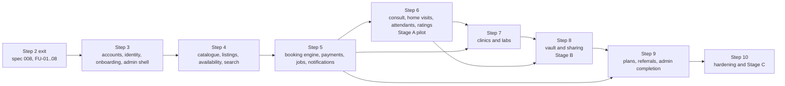

# Web roadmap: Steps 2 to 10 as bounded feature slices

- **Status:** Draft for owner review (28 October 2026). Nothing here is approved. It proposes; the
  owner decides. 
- **Owns:** how each [guideline](mvp-v1-implementation-guideline.md) step breaks into bounded
  feature slices, in dependency order, for a web-only product. It is **not** a second delivery
  plan: the guideline stays the only plan, and where this page proposes a change to it, the change
  is listed under [Proposed guideline amendments](#proposed-guideline-amendments) and applies only
  once the owner merges it into the guideline.
- **Companion:** [requirements traceability](requirements-traceability.md) maps every requirement
  ID and journeys J1 to J9 to a slice, a step, its dependencies and its acceptance proof.
- **Baseline:** `main` at `1ca6493` (28 October 2026): Step 2 built, its exit open
  ([follow-up register](follow-up-register.md#closes-step-2)); specs 001 to 007 Done or deployed,
  [spec 008](archive/specs/008-nested-log-masking/spec.md) Draft; no functional requirement built.

## Contents

1. [Web-only scope](#web-only-scope)
2. [Step 2 blockers, first](#step-2-blockers-first)
3. [How slices become specs](#how-slices-become-specs)
4. [Dependency order](#dependency-order)
5. [Step 3 to Step 10 slices](#step-3-accounts-identity-verification-and-provider-onboarding)
6. [Cross-cutting work per step](#cross-cutting-work-per-step)
7. [Background jobs](#background-jobs)
8. [Integrations](#integrations)
9. [Environments and the first real data](#environments-and-the-first-real-data)
10. [Decisions the owner needs, by step](#decisions-the-owner-needs-by-step)
11. [Proposed guideline amendments](#proposed-guideline-amendments)

## Web-only scope

HEACH ships as three browser applications and one API. There is no native Android or iOS app;
the requirements already put native apps out of scope and make the PWA installable. This page
makes the consequence explicit: every care service, every role and every journey must complete in
a supported browser (UX-08), with the PWA install as an enhancement, never a requirement.

| Surface | App | Users | Designed for |
| --- | --- | --- | --- |
| Patient and provider web app, installable PWA | `apps/web` (Next.js, server rendered, `/or`, `/en`, `/hi`) | Patient, representative, doctor, dentist and dermatologist, physiotherapist, nurse, attendant, sample collector; clinic front desk and lab staff on tablet or desktop | 360 px up (UX-02) |
| Admin website | `apps/admin` (React SPA, English keys) | Super admin, verifier, support, finance | 1280 px down to tablet |
| API and background workers | `apps/api` (NestJS, OpenAPI, typed client in `packages/types`) | All three front ends; payment, SMS and identity callbacks | p95 ≤ 500 ms (PF-04) |

### Browser capabilities each service relies on

Every row has a fallback that works in every supported browser, because Android 9 and iOS 15
(UX-08) lack several of these features. A slice that uses a capability names the fallback in its
spec and tests both.

| Capability | Used by | Where it is missing or limited | Fallback that every browser gets |
| --- | --- | --- | --- |
| WebRTC camera and microphone | Video consultation (OC-01, OC-02) | In-app browsers (WhatsApp, Facebook) often block media; weak networks | Pre-call check detects it and asks to open the link in the browser; audio-only; in-call text chat (A11Y-06) |
| SMS code autofill | OTP sign-in (AC-01, UX-05) | WebOTP is Chromium on Android only and binds to a host name; the dev and pilot hosts have no domain yet (ADR 0009) | `autocomplete="one-time-code"` and manual entry in the existing `OtpField` |
| Web push | Notifications (NT-02) | iOS only for a PWA added to the Home Screen (16.4 and later); not on iOS 15 | In-app notification centre and SMS are the guaranteed channels; push is additive |
| Camera capture for documents | Onboarding (PO-02), vault (MV-03), lab prescriptions (LB-04) | Behaviour varies; some browsers open the file picker | `<input type="file" accept capture>`; file upload always offered |
| Client-side image compression | PO-02, MV-16 | Large images on low-memory phones | Canvas resize in a worker; server enforces limits regardless |
| Resumable upload | MV-16 | None (plain HTTPS) | Multipart upload to object storage through short-lived signed part URLs, retried per part |
| Background sync | Queued actions (PF-07) | Chromium only | Retry on the `online` event and on next open; only non-sensitive actions are queued |
| Geolocation | Clinic distance (IC-03) | Permission denied; desktop accuracy | PIN code entry, distance from the PIN centroid |
| QR scanning | Clinic check-in (IC-06) | `BarcodeDetector` absent in Safari and Firefox | Numeric check-in code typed by the front desk (IC-06 allows code or QR) |
| Speech synthesis in Odia | Attendant voice prompts (PO-07) | Few browsers ship an Odia voice | Recorded Odia audio clips per onboarding step |
| Web Locks, BroadcastChannel | Session refresh across tabs (spec 001) | iOS before 15.4 | Already accepted in spec 001: a race between two tabs is possible there |
| PWA install | Offline shell (PF-07) | iOS has no install prompt | Works in the browser tab; "Add to Home Screen" help text |
| PDF download | Prescriptions (OC-05), receipts (PY-03), lab reports (LB-08) | iOS opens PDFs in a viewer | Served with `Content-Disposition`, behind an access check and a short-lived URL (EN-07) |
| UPI payment | Checkout (PY-01) | Desktop has no UPI app | Gateway's hosted checkout: UPI intent on phones, QR or collect request on desktop |

## Step 2 blockers, first

Step 2 is not complete. Step 3 code needs, in this order:

| # | Blocker | Closes | Who | When | What it unblocks |
| --- | --- | --- | --- | --- | --- |
| 1 | **Nested log masking** (LM-02.1 gap): implement the design in the [archived spec 008](archive/specs/008-nested-log-masking/spec.md) and its [plan](archive/specs/008-nested-log-masking/plan.md) | FU-27; LM-02 back to Done | Claude Code implements; owner reviews the PR | Now | Any Step 3 code that logs a mobile number, name or identity data (3.1 onward) |
| 2 | **Triage the 18 October review findings** (S-3, S-4, S-5, C-3, A-1, P-2, Low items): backlog row or written acceptance each | FU-13 | Owner decides; Claude Code drafts | Before slice 3.0 | Slice 3.0 (S-4 before the identity key is first used; A-1 before Step 3 forms reuse `Toast`) |
| 3 | **Branch protection** decision | FU-10 | Owner | Before Step 3 merges start | Process only |
| 4 | **Admin entry through port forwarding** decision | FU-18 | Owner | Before slice 3.9 | Admin login on dev |
| 5 | **Partner applications submitted**: SMS and DLT (#20), identity partner (#21) now; payment (#19), video (#22), domain (#24) next | FU-09 | Owner | Overdue | Step 3 exit (identity sandbox, real OTP SMS); Steps 5 and 6 |
| 6 | **Rollback drill** | FU-12 | Owner approves; Claude Code prepares | Early in Step 3 | Safe deploys of Step 3 |
| 7 | Weekly restore checks 1, 8, 15 and 22 November, then spec 006 marked Done | FU-01 to FU-05 | Owner (scheduled) | 22 November earliest | Step 2 closure only |
| 8 | Lawyer review of consent wording and the Aadhaar route | FU-06 | Owner | Not dated | Step 2 closure; slices 3.3 and 3.6 |
| 9 | Native Odia review of the 34 Step 2 keys | FU-07 | Owner | Not dated | Step 2 closure; Odia usability test in Step 3 |
| 10 | Real-phone demo in Odia over a throttled network | FU-08 | Owner | Before Step 2 is marked complete | Step 2 closure |

Also open and not blocking: #88 (FU-14 closure record), FU-11, FU-16, FU-17, and documentation gap 19.

## Slices

- The slice keys below (`3.1`, `5.4`) are this page's labels for bounded pieces of work.
- This page and the traceability matrix name requirement IDs, never criterion IDs.
- A slice is small enough when it has one primary journey or one module, one migration set and one
  threat model, and its code fits in one or two pull requests.
- Every slice inherits the [definition of done](mvp-v1-requirements.md#definition-of-done-for-every-feature);
  the per-step additions are under [Cross-cutting work per step](#cross-cutting-work-per-step).

## Dependency order

Hard dependencies that cross steps, so a slice is never specified against something that does not
exist yet:

| Needs | Provided by | Why |
| --- | --- | --- |
| Any personal data in logs | Spec 008 | LM-02 |
| Every upload (onboarding, booking attachments, prescriptions, lab reports, vault) | 3.4 secure upload pipeline | EN-07, PO-02, MV-11 |
| Every provider-facing slice | 3.5 onboarding framework and 3.10 verification | Only Approved providers list services (scope: admin verification before any listing) |
| Every role check after Step 3 | 3.2 roles and linked patients | AC-04, SE-01 |
| Every consent prompt (sign-up, identity, teleconsult, sharing) | 3.3 consent records | PR-01 |
| Sensitive actions (payout details, deletion, mandate changes) | 3.8 OTP re-verification | AC-05, SE-07 |
| Catalogue for all six services | 4.1 | Step 7 reuses it (guideline Step 4 item 1) |
| Slots and locking for clinics and labs | 4.5 | IC-04, LB-02 |
| Background jobs and the outbox | 5.1 | BK-03 auto-cancel, BK-06 reminders, PY-05 payouts, PR-05 retention |
| Payments, refunds and the ledger | 5.3 to 5.7 | Steps 6, 7 and 9 |
| Notification templates and delivery | 5.8 | Every later status change |
| PDF rendering in Odia script | 5.6 (decision D-PDF) | OC-05, PY-03, IC-08, LB-08 |
| Records produced by consults, visits, clinics, labs | Steps 6 and 7 | MV-02 files them into the vault (Step 8) |
| Break-glass | 6.8 | AD-06 complaints, AD-15, MV-11 |
| Entitlements and coupons at checkout | 5.2 designed with hooks (BK-08) | Step 9 attaches without a rewrite |

## Step 3: Accounts, identity verification and provider onboarding

Charter: [Step 3 spec](archive/step-specs/step-03-accounts-onboarding.md) (Draft). Exit: every provider type can
onboard on a phone and be approved in the admin website. Journeys: **J1**, **J5**.

| Slice | Requirements | Depends on | Acceptance proof (summary) |
| --- | --- | --- | --- |
| 3.0 Foundation fixes before personal data | FU-13 findings accepted for a fix (S-3, S-4, S-5, P-2, A-1); retire `user_test`, `patient_note`, sample notes UI; test sign-in kept dev-only behind its loopback gate until 3.1 replaces it | Spec 008; FU-13 triage | Unit and integration tests per finding; sample routes return 404; authz matrix re-run |
| 3.1 OTP sign-up and sign-in | AC-01, AC-02, AC-05 (session persistence), SE-07 (OTP issue and verify), SE-08 (OTP, device and IP throttling, bot challenge), EN-09 (mobile blind index), NT-01 (OTP SMS), UX-05 | 3.0; SMS adapter (fake until #20) | Integration: OTP lifecycle, expiry, attempts, throttles; E2E sign-in in or and en on three viewports |
| 3.2 Roles, representatives and linked patients | AC-03, AC-04, SE-01 (object ownership), SE-02 | 3.1 | Authz matrix per role and object; E2E add, edit, remove a linked patient |
| 3.3 Consent records | PR-01 (sign-up and identity consent), PR-02 | 3.1; lawyer wording (FU-06) for any real user | Integration: versioned text per language, record, withdraw; consent shown before the action it gates |
| 3.4 Secure upload pipeline | EN-07, PO-02, DC-01 | 3.1; scanner decision D-SCAN | Integration: per-object key, private bucket, scan verdict before availability, signed URL after access check and expiry; infected file quarantined |
| 3.5 Onboarding framework | PO-01, PO-03, PO-04 | 3.2, 3.4 | Integration: status machine Draft to Suspended; save and resume; checklists from configuration |
| 3.6 Identity verification | KY-01 to KY-09, PR-03, PR-01 (identity consent) | 3.3, 3.5; partner (FU-09 #21); lawyer (FU-06) | Integration with the identity fake and partner sandbox: no Aadhaar number in database, logs or responses; mismatch to manual review; fallback path |
| 3.7 Role flows: doctor, dentist and dermatologist with clinic, physiotherapist, nurse, attendant (voice prompts), lab, sample collector | PO-01 (role checklists), PO-07, Clinic and Lab entities (identity and documents only) | 3.5, 3.6 | E2E J1 for each provider type; attendant flow with audio prompts and minimal typing |
| 3.8 Payout details with OTP re-verification | PO-06, AC-05 (re-verify), SE-07 | 3.1, 3.5 | Integration: change refused without a fresh OTP; payout fields Restricted and ciphertext |
| 3.9 Admin shell | AD-01, AD-11, SE-04, LM-09 (admin actions) | FU-18; 3.2 | Integration: password plus TOTP; short sessions; masked lists; every admin action in the audit log; audit viewer search and export for super admin |
| 3.10 Verification queue, user management, assisted onboarding | AD-02, AD-03, AD-12, NT-01 (outcome SMS) | 3.6, 3.7, 3.9 | E2E J5; opening documents writes an audit entry; assisted mode needs the provider's OTP consent |
| 3.11 Public provider profile | PO-05, KY-09, SD-05 (profile pages) | 3.10 | E2E: only Approved profiles render, server side, with badges; Lighthouse budget |
| 3.12 Account and data rights | AC-06, PR-04 | 3.1, 3.8 | Integration: view, correct, export, request deletion with OTP; request tracked to completion |

## Step 4: Listings, availability and search

Exit: a patient in a pilot PIN code finds a verified doctor, physiotherapist, nurse and attendant
with open slots. No journey completes yet; J2 to J4 steps 1 and 2 are testable.

| Slice | Requirements | Depends on | Acceptance proof (summary) |
| --- | --- | --- | --- |
| 4.1 Service catalogue for all six services | AD-04 (six catalogue types, amendment A2), I18N-05, SL-06, IC-01 and LB-01 (catalogue data only) | 3.9 | Integration: items with three translations; prescription-required flag; admin edits audited |
| 4.2 Listings for consult, physiotherapy, nursing, attendant | SL-01 to SL-04, SL-07 | 4.1, 3.10 | Integration: only Approved providers publish; pause and resume; attendants cannot list clinical procedures (regulatory point) |
| 4.3 Service area and Odisha PIN codes | SL-05, SD-04 | 4.2; dataset decision D-PIN | Integration: home-visit results limited to the patient's PIN |
| 4.4 Availability rules | AV-01, AV-03, AV-04 | 4.2 | Unit: weekly rules, overrides, leave, buffers, IST only |
| 4.5 Slot generation and locking | AV-02 | 4.4 | Integration and load: two users cannot hold one slot; lock expires after the configured time |
| 4.6 Home screen, search and filters | SD-01, SD-02, SD-03 | 4.2, 4.3, 4.5 | Integration: spelling tolerance across Odia, Hindi, English and transliteration; native Odia relevance review (manual) |
| 4.7 Indexable listing pages | SD-05 | 4.6, 3.11 | E2E and Lighthouse: server rendered, structured data, no patient data |

## Step 5: Booking, payments and notifications

Exit: a patient books and pays for each of the four Stage A service types in the gateway sandbox;
refund and payout entries are correct. J2 to J4 complete up to payment and confirmation.

| Slice | Requirements | Depends on | Acceptance proof (summary) |
| --- | --- | --- | --- |
| 5.1 Booking model, state machine, outbox and job runner | BK-01, BK-02, LM-01 (job correlation) | 4.5; queue decision D-QUEUE | Unit: every allowed and refused transition; integration: event history; job retries and dead letters |
| 5.2 Checkout | BK-04 (policy shown before payment), BK-05 (device attachments), BK-08 (hooks for entitlements and coupons), UX-06 | 5.1, 3.4 | E2E: booking in five steps or fewer; fee breakdown |
| 5.3 Payments adapter and webhooks | PY-01, PY-07 | 5.2; gateway (FU-09 #19) | Integration: signed webhooks, duplicates idempotent, payment success with a failed booking write; card data never reaches the API |
| 5.4 Confirmation rules and acceptance window | BK-03, HS-01 | 5.3 | Integration: consult confirms on payment; home services auto-cancel and refund after the window |
| 5.5 Cancel, reschedule, refunds | BK-04, PY-02 | 5.4 | Integration: refund per policy; refund never exceeds amount paid (TS-09) |
| 5.6 Receipts and invoices; PDF engine | PY-03 | 5.3; decision D-PDF | Integration: PDF with correct Odia shaping, behind access check |
| 5.7 Earnings ledger, commission, payouts | PY-04, PY-05 | 5.5 | Integration: completed booking makes one payout entry; refund after payout handled |
| 5.8 Notifications | NT-01 to NT-03, BK-06, SE-09 (message text) | 5.1; SMS DLT templates (#20); push decision D-PUSH | Integration: templates in three languages, sent in the recipient's language, no health detail; reminders at 24 h and 15 min |
| 5.9 Booking history and offline summary | BK-07, BK-09, PF-07, EN-11 | 5.4 | E2E: summary readable offline, wiped at sign-out; no Restricted data in device storage |
| 5.10 Admin bookings console and finance | AD-05, AD-07 | 5.5, 5.7, 3.9 | E2E admin: search, cancel, reassign, refund; CSV export without Restricted data |
| 5.11 Reconciliation and business metrics | LM-06, LM-07 (payment and OTP alerts) | 5.3, 5.7 | Integration: daily reconciliation with a mismatch alert; zero mismatches over a week of test traffic |

## Step 6: Online consultation, home services and the Stage A pilot

Exit: J2, J3 and J4 pass E2E on three viewports in two languages; Stage A live in pilot districts.
**First real patient data**; see [Environments and the first real data](#environments-and-the-first-real-data).

| Slice | Requirements | Depends on | Acceptance proof (summary) |
| --- | --- | --- | --- |
| 6.1 Video consultation | OC-01, OC-02, OC-06, OC-07, EN-08, A11Y-06 | 5.4; video provider (FU-09 #22) | E2E with the video fake; sandbox trial on rural networks (manual); connect and fallback metrics (LM-06) |
| 6.2 Teleconsult consent and doctor workspace | OC-03, OC-04, PR-01 (teleconsult) | 6.1, 3.3 | Integration: no call without stored consent; doctor sees only own bookings (SE-01) |
| 6.3 Prescription builder and PDF | OC-05 | 6.2, 5.6 | Integration: PDF carries name, qualification, registration number; Restricted and ciphertext |
| 6.4 Home-visit workflow | HS-02, HS-03, HS-04 | 5.4 | E2E J3: address only after confirmation; start code; visit notes Restricted |
| 6.5 Attendant shifts | HS-05 (check-in and out per shift; extend, end early, replacement through support) | 5.4 | E2E J4 |
| 6.6 Safety concerns and complaints | HS-06, RF-03, AD-06 | 5.1, 3.9 | Integration: high-priority ticket; admin queue with assignment and notes |
| 6.7 Ratings and reviews | RF-01, RF-02 | 5.4 | Integration: only after Completed; hide with reason |
| 6.8 Break-glass and patient access history | SE-03, SE-06 | 3.9, 6.2 | Integration: Restricted read needs ticket, reason, expiry; patient sees who read what |
| 6.9 Pilot readiness | SO-04, SO-06, SO-09, TS-08, LM-08, PR-05, PR-06, A11Y-07 (manual pass), UX-07, legal pages in three languages | All of Step 6; amendments A4 to A6 | Pen test with no high open; load test at agreed volume; breach runbook rehearsed; retention job live; DPAs signed |

## Step 7: In-clinic appointments and lab tests

Exit: J6 and J7 work with pilot clinics and labs, behind flags.

| Slice | Requirements | Depends on | Acceptance proof (summary) |
| --- | --- | --- | --- |
| 7.1 Clinic profile, listings, clinic accounts | SL-08, IC-01, IC-02, IC-10 | 4.1, 3.7 | Authz: front desk cannot read clinical notes |
| 7.2 Clinic search with distance | IC-03 | 7.1, 4.6 | Integration: distance from location or PIN centroid |
| 7.3 Clinic booking and payment options | IC-04, IC-05 | 7.1, 4.5, 5.3 | E2E: booking fee, full amount, pay at clinic; remaining amount shown |
| 7.4 Front desk: check-in, statuses, walk-ins | IC-06, IC-07 | 7.3 | E2E tablet: code check-in; walk-in keeps the schedule correct |
| 7.5 Visit summary, follow-up, multi-sitting | IC-08, IC-09 | 7.4, 6.3 | E2E J6 including one-step follow-up (BK-09) |
| 7.6 Lab listings | SL-09, LB-01 | 4.1, 3.7 | Integration: tests and packages with three-language names |
| 7.7 Lab cart, booking, prescription rejection | LB-02, LB-03, LB-04 | 7.6, 5.3, 3.4 | Integration: rejection refunds |
| 7.8 Sample collection | LB-05, LB-06 | 7.7 | Integration: collection code; booking-linked sample identifier |
| 7.9 Status tracking | LB-07 | 7.8, 5.8 | Integration: notification at each step, no health detail |
| 7.10 Report upload and correction | LB-08, LB-10 | 7.8, 3.4 | Integration: report attaches only to its own booking and patient; correction with reason |
| 7.11 Lab dashboard and admin clinic and lab management | LB-11, AD-13 | 7.10, 3.9 | E2E desktop and tablet; a lab cannot see another lab's orders |

## Step 8: E-medical report vault and the Stage B launch

Exit: J9 passes; vault penetration test with no high or medium open; Stage B live.

| Slice | Requirements | Depends on | Acceptance proof (summary) |
| --- | --- | --- | --- |
| 8.1 Vault model, auto-filing and back-fill | MV-01, MV-02, MV-11, LB-09 | 6.3, 6.4, 7.5, 7.10 | Integration: records filed from every source; back-fill for pilot users |
| 8.2 Patient uploads | MV-03, MV-04, MV-15, MV-16 | 3.4 | E2E: resumable upload on a throttled network; quota warning |
| 8.3 Medical history | MV-05 | 8.1 | Integration: attribution per entry |
| 8.4 Timeline and search | MV-06 | 8.1 | E2E: filters and metadata search, no content search |
| 8.5 Per-booking sharing and provider panel | MV-07, MV-08, MV-14, BK-05 (from the vault), PR-01 (sharing consent) | 8.1, 5.2 | Sharing tests in CI (TS-09): unshared, expired, revoked and other-patient records unreadable |
| 8.6 External share link | MV-09 | 8.5 | Integration: expiry, one-time code, revoke |
| 8.7 Access history, download, export, deletion | MV-10, MV-12, SE-06 (vault) | 8.5 | Integration: every read listed; provider-issued records not editable |
| 8.8 Representative transfer | MV-13 | 8.1, 3.2 | Integration: transfer after identity confirmation; representative keeps access only with consent |
| 8.9 Admin vault operations | AD-15 | 8.2, 3.9 | Admin sees counts and requests, never content |

## Step 9: Plans, referrals and admin completion

Exit: J8 works; entitlements and payments reconcile daily with zero mismatch for two weeks.

| Slice | Requirements | Depends on | Acceptance proof (summary) |
| --- | --- | --- | --- |
| 9.1 Plan definitions and plan pages | PK-01, PK-02, PK-03, AD-14 | 4.1, 3.9 | E2E: terms shown in three languages before purchase |
| 9.2 Purchase and entitlement ledger | PK-04, BK-08 | 9.1, 5.2 | Invariant tests (TS-09): use never exceeds purchase |
| 9.3 Mandates and renewals | PK-05, PK-06, PY-06 | 9.2, 5.3, 3.8 | Sandbox: renewal, failure, retry, pause, cancel; pre-debit notice |
| 9.4 Package refunds and per-session payouts | PK-07 | 9.2, 5.7 | Integration: pro-rata refund never exceeds amount paid |
| 9.5 Plan reminders | PK-08 | 9.2, 5.8 | Integration |
| 9.6 Referral codes, rules and coupons | RR-01 to RR-05, RR-07, RR-08 | 5.4, 9.2 | Integration: coupon only after the qualifying event; once per booking; never for steering patients |
| 9.7 Referral abuse controls | RR-06, AD-16, SE-08 (referral redemption) | 9.6 | Integration: self-referral, device and velocity limits; review queue |
| 9.8 Configuration, content, dashboard | AD-08, AD-09, AD-10 | 3.9, 5.10 | Operations change policies, templates, pages without a deploy |
| 9.9 Security console and anomaly alerts | AD-17, SO-08 (anomaly alerts) | 6.8, 3.9 | Integration: unusual-read and failed-authorisation alerts listed |

## Step 10: Hardening, launch readiness and go-live

Exit: the guideline's go-live checklist. Stage C live.

| Slice | Requirements | Acceptance proof (summary) |
| --- | --- | --- |
| 10.1 Full penetration test and dynamic scan | SO-02, SO-04 | Report signed off, no high or medium open |
| 10.2 Load and soak | TS-08, PF-04 | Agreed volume met |
| 10.3 Full regression J1 to J9, three languages, visual review | TS-04, TS-05, TS-07 | Nightly suite green on the release build |
| 10.4 Accessibility audit | A11Y-01 to A11Y-07 | Manual passes on TalkBack, VoiceOver, NVDA recorded |
| 10.5 Real-device Core Web Vitals | PF-01, LM-04 | 75th percentile on a mid-range Android over 3G and 4G |
| 10.6 Disaster recovery and key rotation drills | SO-10, EN-05, EN-10 | Restore from the off-account copy within 4 hours |
| 10.7 Access review | SO-06, SO-07 | Unused accounts removed; no production data outside production |
| 10.8 Fraud review | RR-06, PY-02 | Referral, coupon, refund paths reviewed |
| 10.9 Launch operations | LM-08, UX-07, UX-08, SO-09 | Status page, on-call, support in three languages |

## Cross-cutting work per step

Every slice meets the definition of done. These are the cross-cutting items that land in a
specific step, so they are specified there rather than assumed.

| Area | Step 3 | Step 4 | Step 5 | Step 6 | Steps 7 to 9 | Step 10 |
| --- | --- | --- | --- | --- | --- | --- |
| Accessibility (A11Y) | Axe in unit and E2E for every new screen (A11Y-07); OTP and upload fields labelled with error summaries (A11Y-04); 48 px targets for attendant flows (A11Y-03) | Search and filters by keyboard and screen reader (A11Y-02) | Checkout and payment hand-off accessible | Video controls (A11Y-06); manual pass before pilot | Front-desk and lab tablet screens | Full WCAG 2.2 AA audit (A11Y-01) |
| Languages (I18N) | Every key in or, en, hi; consent text versioned per language; Odia review of new keys before exit | Catalogue in three languages (I18N-05); transliteration search | DLT SMS templates in three languages (NT-03); currency and dates by locale (I18N-03) | Prescription PDF in the patient's language | Lab test common names in three languages (LB-01) | Native review of every catalogue |
| Privacy (PR, DC) | Consent records; data rights; Aadhaar never stored; every field classified | Public data only on listing pages | No health detail in messages (SE-09) | Retention job (PR-05) and DPAs (PR-06) before real data | Vault sharing consent | Legal sign-off |
| Security (SE, SO, EN) | Threat models for auth, identity, uploads, admin; SE-08 throttles; admin MFA | Slot-lock abuse | Payment threat model; webhook signatures | Break-glass; pen test | Vault pen test (Step 8); referral fraud | Full pen test and DAST |
| Performance (PF) | Sign-in and onboarding within PF-02 | Search and profile pages within Core Web Vitals | Checkout budget | Video page loads its SDK on demand only | Vault upload on weak networks | Real-device check |
| Operations (LM, SO) | OTP delivery metric; admin actions audited | Search latency | Job queue backlog alert; reconciliation alert; payment and OTP alerts | Uptime checks, status page, on-call, breach runbook | Lab turnaround metric | DR drill, hypercare |

## Background jobs

One job runner, chosen in slice 5.1 (decision D-QUEUE). Jobs before Step 5 run as today: systemd
timers on the host calling a job entry point under a run ID (re-encryption, restore check).

| Job | Slice | Trigger | Notes |
| --- | --- | --- | --- |
| Virus scan of an upload | 3.4 | On upload | Object unavailable until the verdict; quarantine on detection |
| Expire OTPs, unfinished onboarding reminders | 3.1, 3.5 | Schedule | No personal data in job logs |
| Data-rights request completion | 3.12 | Request | Tracked to a deadline (PR-04) |
| Slot lock expiry | 4.5 | Redis TTL | No job needed if the lock is a TTL key |
| Auto-cancel and refund after the acceptance window | 5.4 | Per booking | Idempotent |
| Reminders 24 h and 15 min before | 5.8 | Per booking | Message text carries no health detail |
| Payment reconciliation | 5.11 | Daily | Alert on mismatch |
| Payout runs | 5.7 | Weekly | Split settlement through the gateway |
| Notification delivery with retry | 5.8 | Outbox | Dead-letter queue and backlog alert (LM-07) |
| Waiting-room no-show alerts | 6.1 | 5 minutes after slot start | OC-06 |
| Retention and anonymisation | 6.9 | Daily | PR-05; must exist before real data |
| Share expiry | 8.5 | Per share | Access check is the real guard; job only tidies |
| Mandate pre-debit notice, renewal, retry, pause | 9.3 | Per mandate | e-mandate rules |
| Plan expiry and low-balance reminders | 9.5 | Daily | PK-08 |
| Entitlement and payment reconciliation | 9.2 | Daily | Zero mismatch for two weeks is an exit criterion |
| Anomaly detection on reads and authorisation failures | 9.9 | Rolling | Extends the Step 2 authorisation-failure alert |

## Integrations

Each sits behind the port in `apps/api/src/adapters` with its test double (TS-06). The real adapter
arrives in the slice named; nightly sandbox runs start then.

| Integration | Port today | Real adapter in | Partner issue | Notes |
| --- | --- | --- | --- | --- |
| SMS and OTP (DLT) | `sms.port.ts` | 3.1 | #20 | DLT templates take weeks; fake until approved |
| Identity (Aadhaar via a permitted route, DigiLocker) | `identity.port.ts` | 3.6 | #21 | Route and consent wording need the lawyer (FU-06) |
| Virus scanning | None | 3.4 | None | Decision D-SCAN |
| Payment gateway (UPI, cards, net banking, refunds, split settlement, mandates) | `payments.port.ts` | 5.3; mandates 9.3 | #19 | Hosted checkout only (PY-07); callback URLs may need a domain (ADR 0009) |
| Web push | None | 5.8 | None | Decision D-PUSH |
| PDF rendering | None | 5.6 | None | Decision D-PDF |
| Video (managed WebRTC, India media) | `video.port.ts` | 6.1 | #22 | Low-bandwidth trial before choosing |
| Maps | None | 7.1 | None | Links out to a map with the address; no embedded map SDK, no tracking |
| Error tracking, uptime, status page | GlitchTip local (ADR 0010) | 6.9 | None | FU-22 at the pilot |

## Environments and the first real data

Today there is one dev host on credits (ADRs 0008, 0009); credits end 17 April 2027
([credit plan](credit-expiry-plan.md)). Steps 3 to 5 fit that. Step 6 brings the first real
patient data, which needs, before any real user signs in:

1. A production environment separate from dev (SO-07), on the paid plan; an ADR replacing or
   extending ADR 0008 if it adds managed services (CLAUDE.md: keep the lean design until then).
2. The pilot-gate deferrals closed or renewed in writing: trusted certificate (FU-20), Secrets
   Manager and WAF (FU-21), central error tracking (FU-22), escrow wrap (FU-23), pen test and scan
   policy (FU-24), shared rate-limit counters if more than one process (FU-25), key rotation
   schedule (FU-26).
3. Retention (PR-05) and processor agreements (PR-06), legal pages and grievance officer details
   in three languages, the lawyer's sign-off on consent texts.
4. Branch protection (FU-10) and a proven rollback (FU-12).
5. Capacity: a virus scanner and job workers on the same `t4g.small` (2 GB) may not fit; slice 3.4
   measures it and, if needed, proposes a size change by ADR before Step 6.

## Decisions the owner needs, by step

Requirement open questions and technical choices, with the step they block. Each is settled in
the step charter or feature spec named; until then that spec stays Draft.

| Key | Decision | Blocks | Recommendation (in-stack first) |
| --- | --- | --- | --- |
| Q-OPERATOR | Who operates the application | Step 3 consent and terms; Step 6 legal | Owner |
| Q-AADHAAR | Aadhaar and DigiLocker route: direct or licensed partner | 3.6 | Lawyer and owner (FU-06, #21) |
| Q-AGENCY | Attendants as freelancers only, or agencies too | 3.7 | Freelancers only for the first release; agencies later |
| Q-OUTSTATE | Doctors registered outside Odisha | 3.7, 3.10 | Lawyer |
| Q-POLICE | Background or police verification for home-visit providers and attendants | 3.7, 3.10 | Owner and lawyer; make it a checklist item so it can be added without code |
| Q-PATIENT-KYC | Identity verification mandatory for patients in any case (for example attendant bookings) | 3.6, 5.2 | Owner |
| Q-HINDI | Hindi at launch | Every step's translation work | Keep three languages (requirements and CLAUDE.md) unless the owner changes both |
| D-SCAN | Virus scanner | 3.4 | ClamAV as its own container (GPL-2.0, not linked into our code) versus a managed scan service (cost, availability on the plan); measure memory on the host |
| D-ADMIN-MFA | Admin second factor | 3.9 | TOTP with `node:crypto` (no new dependency); WebAuthn later |
| D-GRID | Admin data-grid library (the stack names one, none chosen) | 3.9 | Extend `packages/ui` `Table` with server-side sort and pagination first; a library only if that falls short |
| D-PIN | Odisha PIN code dataset and its licence | 4.3 | India Post open data under the Government Open Data Licence, loaded by migration |
| D-SEARCH | Search engine | 4.6 | PostgreSQL `pg_trgm` and a per-language synonym and transliteration table; no new service |
| D-QUEUE | Job runner | 5.1 | PostgreSQL outbox and job table with `FOR UPDATE SKIP LOCKED` (commits with the booking, no new dependency) versus a Redis queue library (new dependency) |
| D-PDF | PDF rendering that shapes Odia script correctly | 5.6 | Spike first: render one Odia prescription with each candidate; headless Chromium is reliable for shaping but heavy on the host |
| D-PUSH | Web push library | 5.8 | `web-push` (MPL-2.0) rather than hand-written payload encryption (no improvised cryptography: `@heach/crypto` and audited libraries only) |
| Q-CASH | Cash or UPI at the time of home service | 5.3 | Online only for the first release |
| Q-COMMISSION | Commission and cancellation policy per service | 5.5, 5.7 | Owner; configurable, so not a code blocker |
| Q-LOAD | Expected launch load | 4.5 load test, TS-08 | Owner |
| Q-AUDIO-ONLY | Audio-only and chat-only consults as separate services | 6.1 | Owner |
| Q-CLINIC-PAY | Clinics collect the balance themselves | 7.3 | Owner |
| Q-LABS | NABL only; who collects samples | 7.6, 7.8 | Owner |
| Q-VAULT | Retention, quota, paid storage; may providers download shared records | 8.2, 8.5 | Lawyer and owner |
| Q-PLANS | First plans, prices, who funds entitlements; coupon values and caps | 9.1, 9.6 | Owner |
| Q-SUPPORT | First-line support languages and hours | 6.9 | Owner |
| Q-NAME | Product name and domain | WebOTP binding, push, partner callbacks, SEO | Owner (#24) |

## Proposed guideline amendments

For the owner to accept or reject. Accepted ones are applied to the guideline (and, where
noted, the requirements) in their own docs pull request; until then the guideline stands.

| # | Amendment | Why |
| --- | --- | --- |
| A1 | Assign the 37 unassigned requirement IDs (documentation gap 1) to the steps in the [traceability matrix](requirements-traceability.md) | So none can be missed |
| A2 | AD-04 covers all six catalogue types (dental and skin treatments, lab tests too) | Documentation gap 7; guideline Step 4 already says so |
| A3 | State that the product is web only: every journey completes in a supported browser; native apps stay out of scope; each browser capability has a fallback (table above) | Makes UX-08 testable per journey |
| A4 | Move SE-03 break-glass and SE-06 access history into Step 6 build items, before any admin handles complaints with health data | Guideline lists SE-06 in Step 6 but not SE-03 |
| A5 | Move PR-05 retention and PR-06 processor agreements into Step 6 pilot readiness | Required before the first real record, not at go-live |
| A6 | Publish legal pages from the i18n catalogue in Step 6; AD-09 (admin-editable pages) stays in Step 9 | The pilot needs terms, privacy notice and grievance details |
| A7 | Add "open questions settled in the step charter" as an entry condition of each step, with the keys above | Documentation gap 10 |
| A8 | A production environment decision (ADR) as a Step 6 entry condition | ADR 0009 covers dev only; credits end 17 April 2027 |
| A9 | Verifier access to identity verification results (Restricted) is a purpose-bound, audited read in the verification queue, not a break-glass action | AD-02 needs it every day; SE-03 as written would make every review a break-glass (Step 3 charter, open question) |
